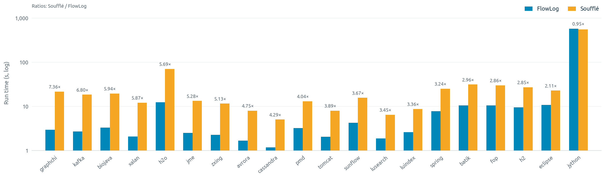
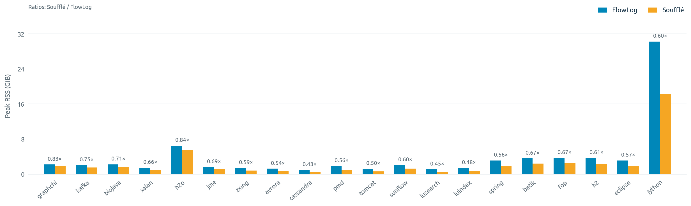

# FlowLog vs Soufflé: 16-thread DOOP benchmarks

November 23, 2026 · **FlowLog compiler 0.9.1 / runtime 0.7.1, batch** · **Soufflé 2.5**

**20 completed comparisons, 120 successful executions.** This
snapshot reruns the DOOP default points-to analysis (`doop/default.dl`) on all
20 DaCapo datasets at 16 threads to refresh the FlowLog README figures.
Other workloads were not rerun; the [2026-09-24 snapshot](../2026-09-24/README.md)
remains the 32-thread record for the full suite.

| Comparisons | FlowLog faster | Geometric-mean speedup | Speedup range | Soufflé lower peak RSS | FlowLog/Soufflé peak RSS |
|---:|---:|---:|---:|---:|---:|
| 20 | 19/20 | **3.87×** | 0.95–7.36× | 20/20 | 1.65× (geomean) |

Speedup means **Soufflé wall time / FlowLog wall time**; above 1 favors FlowLog.

## DOOP

Both charts use descending runtime speedup order. FlowLog uses light-theme blue
(`#0087B9`); Soufflé uses orange (`#F5A623`). Plot code and style are unchanged
from the 2026-09-24 snapshot.





Vector versions: [runtime](doop-time.svg) · [memory](doop-memory.svg).
Memory uses a linear GiB scale, as in the engine README.

## Complete results table

Times are median **whole-process wall-clock seconds** over three executions,
including input loading but excluding compilation. RAM is the median of
per-execution peak RSS in MiB. Speedups use the unrounded recorded medians.

| Dataset | FlowLog (s) | Soufflé (s) | Speedup | FlowLog RAM (MiB) | Soufflé RAM (MiB) |
|---|---:|---:|---:|---:|---:|
| avrora | 1.67 | 7.93 | 4.75× | 1,254.9 | 673.6 |
| batik | 10.48 | 31.06 | 2.96× | 3,673.2 | 2,458.0 |
| biojava | 3.28 | 19.47 | 5.94× | 2,268.3 | 1,612.6 |
| cassandra | 1.17 | 5.02 | 4.29× | 959.4 | 412.9 |
| eclipse | 10.77 | 22.72 | 2.11× | 3,167.4 | 1,801.0 |
| fop | 10.45 | 29.85 | 2.86× | 3,804.6 | 2,565.1 |
| graphchi | 2.92 | 21.50 | 7.36× | 2,233.8 | 1,855.4 |
| h2 | 9.46 | 26.92 | 2.85× | 3,764.0 | 2,308.6 |
| h2o | 12.32 | 70.04 | 5.69× | 6,639.2 | 5,607.2 |
| jme | 2.50 | 13.20 | 5.28× | 1,651.6 | 1,142.6 |
| jython | 574.95 | 547.91 | 0.95× | 30,965.4 | 18,596.7 |
| kafka | 2.70 | 18.36 | 6.80× | 2,065.3 | 1,552.7 |
| luindex | 2.59 | 8.70 | 3.36× | 1,445.5 | 696.8 |
| lusearch | 1.86 | 6.41 | 3.45× | 1,122.0 | 510.2 |
| pmd | 3.21 | 12.97 | 4.04× | 1,870.0 | 1,043.5 |
| spring | 7.72 | 24.99 | 3.24× | 3,196.3 | 1,797.7 |
| sunflow | 4.25 | 15.58 | 3.67× | 2,081.5 | 1,243.6 |
| tomcat | 2.04 | 7.94 | 3.89× | 1,218.8 | 606.3 |
| xalan | 2.05 | 12.03 | 5.87× | 1,485.2 | 983.0 |
| zxing | 2.25 | 11.54 | 5.13× | 1,439.1 | 842.0 |

Every case agrees on all 26 shared reported relation counts, including
`VarPointsTo`, across both engines and all three attempts. This is **not full
tuple-by-tuple verification**.

## Method and provenance

| Setting | Value |
|---|---|
| Measurement interval | November 23, 2026, 08:41:38–10:12:58 UTC |
| FlowLog commit | `40ca7b979aa7b57e7f359203f80f569a7b799fc4` (release PR [flowlog-rs/flowlog#637](https://github.com/flowlog-rs/flowlog/pull/637)) |
| Benchmark corpus commit | `0757767f4211d6fb6acbdb466d33d043d3c2443d` |
| Prepared dataset revision | `da9e91b3ff75d94604f57ba2b21ef3aa97e241ec` |
| Host | AMD EPYC 7V13; 24 physical cores / 24 logical CPUs; approximately 216 GiB RAM |
| CPU placement | Same 16 physical cores (CPUs 0–15) for both engines; no SMT on this host; NUMA node 0 memory binding |
| FlowLog compilation | Release build; `--str-intern`; batch; runtime source pinned to that commit |
| FlowLog execution | `-w 16` |
| Soufflé compilation | `souffle -o <binary> -j 16 -F <facts> <program>` |
| Soufflé execution | `<binary> -j 16 -F <facts> -D <output>` |
| Profiling | Disabled in both timed executables |
| Samples | Three measured executions per engine/case; engines and cases run serially |
| Time metric | GNU-time process wall time; 0.01-second resolution; compile time excluded |
| Memory metric | GNU-time peak RSS per execution; median reported |
| Cache policy | No explicit warm-up or cache flush; ordinary OS-cache behavior |
| Per-execution timeout | 1,800 seconds; no measured execution failed or timed out |
| Toolchain | Rust/Cargo 1.97.1; Soufflé 2.5 with OpenMP; g++ 11.4.0 |
| Memory-map limit | `vm.max_map_count=65530` (host default); highest sampled map count: FlowLog 154, Soufflé 132 |

### Changes from the 2026-09-24 run

- **Threads:** 16 instead of 32, for both engines.
- **FlowLog:** compiler 0.9.1 / runtime 0.7.1 instead of 0.7.0 / 0.5.0.
  This compiler has no `--mode` flag; it builds batch whenever every input
  relation is static, as in DOOP, so the run drops `--mode batch` from the
  FlowLog flags and keeps every other flag.
- **Host:** AMD EPYC 7V13 VM instead of AMD EPYC 7763, and Rust 1.97.1
  instead of 1.95.0. Absolute times are therefore not comparable across the
  two snapshots.
- **Memory-map limit:** the host default was kept because the run had no root
  access; the sampled peaks above stay far below it.
- **Soufflé install:** the same 2.5 release, from its official
  `x86_64-ubuntu-2204-souffle-2.5-Linux.deb` (SHA-512 verified), unpacked
  without root. Its `souffle-compile.py` only points include and library paths
  at the unpacked files; compiler flags (`-O3 -fopenmp -std=c++17` and the
  package's definitions) are unchanged.

### Source verification

The release tags and the published runtime crate point to `625d1c1`
([flowlog-rs/flowlog#648](https://github.com/flowlog-rs/flowlog/pull/648)), the
commit after the benchmarked one. The two commits differ only in a
dev-dependency in `flowlog-runtime/Cargo.toml`, which is not built into
generated programs, so the compiler source matches the tagged release. Apart
from `Cargo.toml`, all 70 files of the pinned runtime source, including its
66 Rust files, are byte-identical to the published
`flowlog-runtime` 0.7.1 crate, whose checksum was verified against
crates.io. Each generated program's Cargo metadata was verified to resolve
`flowlog-runtime` from the pinned source, and the Soufflé binary was verified
to link OpenMP.

All 20 DOOP input archives were SHA256 verified against the pinned HuggingFace
dataset revision. No engine source, harness script, or Datalog program was
modified.

## Data and plot reproduction

- [All 20 case outcomes](all_results.csv): the source of both the table and plots.
- [All 120 execution measurements](attempts.csv): portable timing/RSS data, without local filesystem paths.
- [Aggregate statistics](summary.json).
- [Machine-readable provenance](metadata.json).
- [Render script](render.py): reproduces the figures and this document, without rerunning benchmarks.

With Python, Matplotlib, NumPy, and the Ubuntu font installed, run from the
repository root. On Ubuntu the font package is `fonts-ubuntu`.
SVG text is saved as outlines so the typography is preserved on other systems.
These figures were rendered with Ubuntu 22.04's packaged Matplotlib 3.5.1,
NumPy 1.21.5, and FreeType 2.11.1, which also reproduce the 2026-09-24 figures
byte for byte; other builds can differ slightly in antialiasing.

```bash
python3 docs/benchmarks/2026-11-23/render.py
```

These plots use whole-process wall time for **both** engines. The harness's
`Compiler_Total` column instead reports FlowLog's internal dataflow time; it is
preserved as `flowlog_dataflow_s` in the CSV but is **not** the plotted
baseline.
